  

Hey, I'm Priyanshu 👋

I build full-stack web apps, mostly on the MERN stack, and picked up React Native along the way. Lately I've been spending time in other people's codebases: finding bugs in the React and Next.js libraries I use, writing a failing test, and sending the fix upstream.

### Things I've built

- **[AlumniVerse](https://github.com/lord-0011/AlumniVerse)**: alumni networking platform that keeps alumni data and engagement in one place. MERN + Socket.io. [Live demo](https://alumni-verse-frontend.vercel.app)
- **[Wanderlust](https://github.com/lord-0011/Wanderlust)**: full-stack app for discovering travel destinations. Node, Express, EJS.
- **[UniFinder](https://github.com/lord-0011/UniFinder)**: search and filter universities. React.
- **Amazon Clone**: e-commerce UI with a working cart. React.
- A handful of small React Native apps from learning it: [Mini Spotify](https://github.com/lord-0011/MiniSpotify), [Currency Converter](https://github.com/lord-0011/CurrencyConverter), [Tic-Tac-Toe](https://github.com/lord-0011/TicTacToeApp), [Password Generator](https://github.com/lord-0011/Password-Generator).

### Open source

Merged:

- **[Mantine](https://github.com/mantinedev/mantine/pull/9371)**: `NumberInput` no longer overrides the `inputMode` prop you pass it
- **[React Flow](https://github.com/xyflow/xyflow/pull/6108)**: ignore `ResizeObserver` entries without a `contentRect` in the pane extent cache
- **[Zag](https://github.com/chakra-ui/zag/pull/3574)**: combobox only scrolls its own list when bringing the highlighted item into view
- **[Fumadocs](https://github.com/fuma-nama/fumadocs/pull/3803)**: links to tabs and accordions with non-English ids now open them

In review (11)

 

- **Zag** [#3626](https://github.com/chakra-ui/zag/pull/3626): keep the highlighted item in view inside a nested scroll area
- **Radix UI** [#4267](https://github.com/radix-ui/primitives/pull/4267): controlled Tabs no longer fire `onValueChange` twice per click
- **Base UI** [#6201](https://github.com/mui/base-ui/pull/6201): toast stack collapses when the pointer leaves after closing the hovered toast
- **React Router** [#15721](https://github.com/remix-run/react-router/pull/15721): no more nonce hydration warning from `<Links>`
- **Fumadocs** [#3806](https://github.com/fuma-nama/fumadocs/pull/3806): search close button's accessible name includes its visible text
- **Nextra** [#5062](https://github.com/shuding/nextra/pull/5062): respect `prefers-reduced-motion` when the TOC scrolls
- **Nextra** [#5063](https://github.com/shuding/nextra/pull/5063): navbar logo link takes its name from the visible logo text
- **Nextra** [#5064](https://github.com/shuding/nextra/pull/5064): lite theme switch includes the current theme in its name
- **next-intl** [#2448](https://github.com/amannn/next-intl/pull/2448): support built-in date and time styles in precompiled messages
- **next-intl** [#2457](https://github.com/amannn/next-intl/pull/2457): one invalid `accept-language` entry no longer throws away the rest
- **Kan** [#681](https://github.com/kanbn/kan/pull/681): avatar crop dialog fits on a phone screen

[All my pull requests →](https://github.com/search?q=author%3Alord-0011+is%3Apr+-user%3Alord-0011&type=pullrequests&s=created&o=desc)

### Stack

JavaScript / TypeScript · React · Next.js · Node + Express · MongoDB · Socket.io · React Native · C++ for DSA

Currently learning system design, backend performance with Redis, and grinding DSA.

 

<picture>
  <source media="(prefers-color-scheme: dark)" srcset="https://raw.githubusercontent.com/lord-0011/lord-0011/output/github-snake-dark.svg" />
  
</picture>
